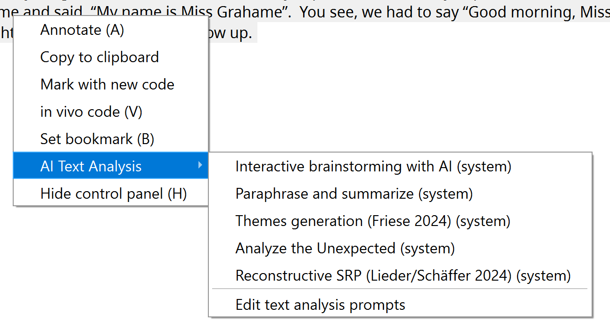
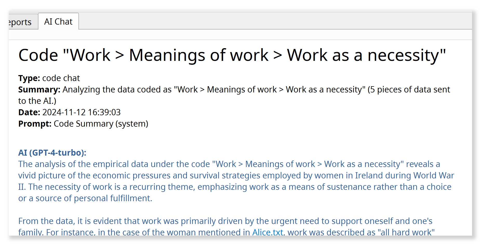

# Analizar datos con el agente de IA

## Principios fundamentales de la integración de IA {#core-principles-of-ai-integration}

**1) Elección de los modelos de IA**

El agente de IA de QualCoder no está vinculado a un modelo concreto. Usted decide qué modelo de lenguaje de IA utilizar, ya sea uno de los grandes modelos comerciales, un modelo de tamaño medio en una plataforma académica de IA o un modelo de lenguaje local en su propia computadora. Para más información, vea [Configuración de la IA](./2.3.-AI-Setup).

**2) Flexibilidad metodológica**

El agente de IA de QualCoder no define un método propio. En su lugar, ofrece una plataforma de experimentación flexible desde el punto de vista metodológico. Su pregunta de investigación, los hallazgos que busca y su enfoque metodológico marcan la dirección. Cuando un enfoque ha demostrado su utilidad, puede guardarlo y reutilizarlo más adelante (vea la [Biblioteca de prompts de IA](./6.3.-AI-Prompt-Library)).

**3) Transparencia**

Los prompts que guían el trabajo del agente de IA son accesibles y, en principio, pueden adaptarse. Mientras trabaja, el agente también le mantiene informado de sus pasos y proporciona referencias detalladas a las fuentes. Así puede ver en qué datos se basa y examinar los pasajes en su contexto original.

**4) Colaboración en lugar de automatización**

El foco está en trabajar con la IA mediante el diálogo: desarrollar perspectivas adicionales, cuestionar sus propias interpretaciones y comprender mejor el material. Si se lo solicita, el agente también puede realizar tareas más largas de forma semiautónoma. Sin embargo, la automatización a gran escala nunca ha sido el objetivo principal.

## Trabajar con el agente de IA {#working-with-the-ai-agent}

- El agente de IA tiene su **propia pestaña** en QualCoder. También puede moverlo a una **barra lateral** (vea más abajo), junto a sus datos, haciendo clic en el pequeño botón con una flecha.
{ width="118" }
- En la ventana de chat, describa con sus propias palabras qué desea investigar o trabajar.

{ width="600" }

!!! note
    La IA debe estar **completamente cargada** y lista para nuevas consultas antes de poder iniciar un chat (barra de estado: "AI: ready").

### ¿Para qué sirve el agente de IA? {#what-is-the-ai-agent-for}

- El agente de IA le ayuda a **explorar su material empírico,** desarrollar interpretaciones y análisis, codificar datos y redactar memos.
- Puede discutir pasajes concretos con la IA o buscar en todo el corpus del proyecto temas o casos contrastantes.
- Puede desarrollar su sistema de códigos, generar ideas y estrategias analíticas, y contrastarlas directamente con los datos empíricos.
- A diferencia de los chatbots genéricos, el agente de IA de QualCoder **retoma el trabajo exactamente donde lo dejó su análisis:** examina el sistema de códigos actual, puede leer memos y pasajes codificados, incorporar al análisis los casos y sus características (atributos), y más. Así obtiene una retroalimentación adaptada a la etapa actual de su investigación.

### ¿Qué puede hacer el agente de IA? {#what-can-the-ai-agent-do}

- Incluso con solo **acceso de lectura** al proyecto, el agente de IA ya es una herramienta potente para generar ideas.
- Si se lo solicita, también puede **hacer avanzar activamente el análisis**. Con los permisos adecuados (vea más abajo), puede crear códigos nuevos o reorganizar los existentes, encontrar y codificar nuevos pasajes de texto, revisar memos o crear nuevos atributos de caso.
- En la conversación con el agente, puede revisar sus sugerencias, hacer preguntas de seguimiento y decidir cómo continuar.

### ¿Cuáles son sus limitaciones? {#what-are-its-limitations}

- Actualmente, el agente de IA solo puede trabajar con **datos de texto**, no con imágenes, audio ni video. Los diarios de QualCoder también quedan excluidos por ahora.
- Puede elegir entre tres niveles de permisos:

|Nivel de permisos|Descripción|
|---|---|
|**Read-only** (solo lectura)|El agente de IA solo tiene acceso de lectura a los códigos, los memos y los datos empíricos.|
|**Sandboxed** (entorno aislado, predeterminado)|Acceso de escritura limitado: el agente puede crear sus propios códigos y codificaciones, pero no puede modificar los existentes.|
|**Full access** (acceso completo)|El agente puede hacer casi todo lo que puede hacer un usuario humano, incluidos cambios en el sistema de códigos, los casos, los memos y los atributos.|

- Siempre se aplica un **límite estricto**: los documentos empíricos constituyen la "verdad de base" de todo el análisis. Bajo ninguna circunstancia la IA puede modificarlos.
- El agente de IA tampoco tiene **acceso a información externa,** como la información de internet. Por lo tanto, solo puede trabajar con los datos que usted haya incluido deliberadamente en el proyecto.

### ¿Cómo puedo ver qué cambios hace la IA? {#how-can-i-see-which-changes-the-ai-makes}

- El agente **documenta sus pasos en el chat,** proporciona referencias a las fuentes y pregunta antes de hacer cambios importantes.
- Puede **deshacer** fácilmente los últimos cambios del agente de IA con el botón correspondiente de la ventana de chat:

    { width="250" }

- Todos los nuevos elementos que crea el agente (códigos, codificaciones, etc.) se identifican con el **nombre de codificador especial "AI Agent".**

    { width="600" }

- Para **mostrar u ocultar** los códigos generados por la IA, haga clic en los tres puntos ("...") de la parte superior izquierda del diálogo de codificación, junto al nombre del codificador actual, y ajuste la visibilidad de "AI Agent".

    { width="250" }

### ¿Cómo debo preparar mi proyecto? {#how-should-i-prepare-my-project}

- Un buen **memo del proyecto** es muy importante (menú "Project > Project memo"). Debe contener:

    - La pregunta de investigación y los objetivos del proyecto
    - El tipo de material empírico (por ejemplo, entrevistas narrativas) y el enfoque de muestreo
    - El enfoque metodológico del análisis
    - Cualquier otro detalle que el agente de IA deba tener en cuenta.

    El memo del proyecto se proporciona al agente como información de contexto en cada conversación.

- Además, los **nombres de los documentos** deben ser significativos (por ejemplo, "Entrevista Alicia").
- En las **transcripciones de entrevistas**, entrevistadores y entrevistados deben identificarse claramente, de modo que sus roles sean reconocibles incluso en extractos breves.
- Unos buenos **memos de códigos** también ayudan a la IA a entender lo que usted quiere decir.

!!! note
    **Check project AI readiness:** con este comando del menú "AI", el agente analiza automáticamente el proyecto y sugiere formas de mejorar su legibilidad.

!!! note
    **Notas personales en los memos:** si también desea usar los memos para notas personales, escríbalas después del separador `#####`. Todo lo que esté después es inaccesible para la IA.

### ¿Cómo funciona el agente de IA? {#how-does-the-ai-agent-work}

- El agente de IA solo actúa cuando usted le asigna una **tarea**, no por iniciativa propia.
- El agente resuelve una tarea mediante un **bucle ReAct** (Reflect + Act, [Shunyu et al. 2022](https://arxiv.org/abs/2210.03629)):

    1. Elabora un plan para realizar la tarea.
    2. Ejecuta las acciones previstas (por ejemplo, buscar datos o leer códigos).
    3. Analiza los resultados y decide si se necesitan más acciones (por ejemplo, leer más datos). Si es así, vuelve al paso 2.

    Según la complejidad de la tarea, este bucle puede repetirse muchas veces. Los pasos individuales se muestran en gris en la ventana de chat.
    Cuando el resultado es satisfactorio (por ejemplo, cuando se han encontrado suficientes datos), el agente formula una respuesta final y espera nuevas instrucciones.

- El agente dispone de **herramientas potentes:** por ejemplo, puede realizar una búsqueda por similitud semántica en todo el corpus, buscar mediante expresiones regulares o un índice de palabras clave BM25, y usar herramientas para crear o modificar códigos si tiene permisos de escritura.

### ¿Qué ocurre con mis datos? {#what-happens-to-my-data}

- Todos los datos se conservan **localmente en su computadora**, en el proyecto de QualCoder actual. Las operaciones de búsqueda mencionadas también se ejecutan localmente.
- El **modelo de IA solo ve la parte de los datos** (por ejemplo, resultados de búsqueda o pasajes concretos) que se necesita específicamente para el análisis en curso. Estos fragmentos de datos se envían al modelo de IA junto con la tarea correspondiente.
- En sus respuestas, el agente de IA documenta con detalle los datos en los que se basan sus análisis. QualCoder convierte estas referencias en **enlaces a las fuentes con números de línea.** Al hacer clic en una referencia se abre el pasaje en su contexto original.

## Cuatro formas de iniciar una conversación con el agente {#four-ways-to-start-a-conversation-with-the-agent}

En la parte inferior izquierda de la ventana del agente de IA, puede iniciar un nuevo análisis de una de estas cuatro formas:

{ width="250" }

Estas opciones simplemente ofrecen **distintos puntos de partida** para el análisis. Después puede llevar la conversación en la dirección que elija, usando el conjunto completo de herramientas de que dispone el agente.

### 1) Nuevo chat abierto {#1-new-open-chat}

Esta es la forma más flexible de iniciar un nuevo análisis con el agente. Comience con una idea o una pregunta abierta, o nombre los códigos o pasajes que desea investigar.

**Ejemplo: encontrar casos comparables**

> *"A partir de la línea 127, Sarah habla de su infancia en Inglaterra y de que allí su padre era su principal cuidador. ¿Hay casos similares en el material en los que los hombres desempeñen un papel tan central en el cuidado de los hijos?"*

**Ejemplo: consolidar códigos**

> *"Tengo la impresión de que los códigos 'Responsabilidad personal' e 'Independencia' se solapan a menudo. Revisa los memos y los pasajes codificados. ¿Cómo podríamos distinguir los códigos con más claridad? ¿O sería mejor fusionarlos?"*
>
> Después: *"Bien, fusiona ambos códigos bajo el nuevo nombre 'Hacerse responsable de uno mismo' y actualiza el memo del código en consecuencia."*

**Ejemplo: obtener información**

> *Examina todas las entrevistas para identificar la postura de cada persona entrevistada sobre las restricciones al uso de redes sociales por parte de niños y/o adolescentes. Asigna a cada persona entrevistada exactamente una categoría:
> **pro** = explícitamente a favor de las restricciones;
> **contra** = explícitamente en contra de las restricciones;
> **undecided** = declaraciones pertinentes que son ambivalentes, contradictorias o que no pueden asignarse con claridad;
> **unknown** = ninguna declaración suficientemente pertinente.
> Considera solo las posturas que puedan atribuirse claramente a la persona entrevistada y revisa el contexto de los pasajes que encuentres. Primero, muéstrame la categoría propuesta para cada persona, una breve explicación y los pasajes clave con referencias a las fuentes. Señala explícitamente las contradicciones y las asignaciones inciertas.
> Solo después de que yo lo confirme, crea el atributo "social_media_restriction" para las transcripciones de entrevistas con los valores permitidos "pro", "contra", "undecided" y "unknown", y guarda las asignaciones.*

Para incorporar a la conversación **prompts predefinidos o sus propios prompts** de la [Biblioteca de prompts de IA](./6.3.-AI-Prompt-Library), use la 'notación con barra': por ejemplo, "/in-vivo-coding" insertaría en la conversación actual el prompt correspondiente que haya creado previamente en la Biblioteca de prompts.

### 2) Exploración de temas {#2-topic-exploration}

Este tipo de análisis es especialmente útil para obtener una **primera visión general** de cómo se aborda un tema concreto en el material empírico. Para preguntas de investigación sencillas con temas claramente definidos, también puede usar esta función para elaborar análisis de síntesis que pueden convertirse directamente en un informe.

- Esta opción abre un **diálogo** en el que puede definir y describir el tema y seleccionar los datos que se incluirán en el análisis.
- También puede elegir entre distintos **prompts analíticos**, como un resumen sencillo (topic-summary) o un análisis comparativo de casos (analyze-differences). Puede crear plantillas para sus propios análisis con instrucciones detalladas en la [Biblioteca de prompts de IA](./6.3.-AI-Prompt-Library) y luego usarlas aquí.
- La exploración de temas primero realiza una búsqueda en varios pasos en el material y luego presenta un informe inicial.

**Ejemplo: comparación exploratoria de casos**

> **Tema:** "Criar hijos en tiempos de guerra"
> **Descripción:** "¿Cómo afecta la guerra a la decisión de tener hijos? ¿Cómo cambia el trabajo de cuidados en tiempos de guerra? ¿Cómo intentan los padres hacer posible la infancia en condiciones de guerra?"
> **Prompt analítico:** "analyze-differences"
> **Filtro:** Solo se seleccionan los casos "Ethel" y "Flora".
>
> **Resultado:** Un análisis comparativo de Ethel y Flora sobre el tema "Criar hijos en tiempos de guerra", estructurado en torno a las tres subpreguntas.

### 3) Análisis de texto {#3-text-analysis}

- Permite un **análisis detallado de un pasaje seleccionado** con el agente de IA.
- Desarrolle conjuntamente nuevas lecturas y sugerencias de códigos, o discuta ambigüedades, incertidumbres y cuestiones de interpretación sin resolver.

Este análisis cambia primero al **espacio de trabajo de codificación de texto**.
Abra allí un documento, seleccione el pasaje que desea analizar y elija "AI Text Analysis" en el menú contextual. Se abre un **submenú** en el que puede elegir entre distintos tipos de análisis de texto:

{ width="600" }

Pase el puntero brevemente sobre una opción para ver una información sobre herramientas con más detalles.
También puede guardar sus propias instrucciones de análisis de texto en la [Biblioteca de prompts de IA](./6.3.-AI-Prompt-Library). Entonces también aparecerán como opciones en este submenú.

**Ejemplo: lluvia de ideas en las primeras etapas de la lectura detallada**

> a) **Seleccione** un pasaje de entrevista especialmente rico en la pestaña "Code text".
> b) Haga clic derecho y elija "AI Text Analysis" > **"interactive-brainstorming-with-ai"**.
> c) El espacio de trabajo cambia a la pestaña "AI Agent". Allí, el agente pregunta primero por la **perspectiva analítica** o el tema que desea explorar con más profundidad.
> d) Comienza entonces una **conversación sobre el material**, en la que exploran y discuten juntos distintas interpretaciones posibles.
> e) **Guarde los resultados:** cuando termine, indique al agente de IA que guarde un resumen de los resultados como anotación de texto.

### 4) Análisis de códigos {#4-code-analysis}

- Analiza todos los **datos reunidos bajo un código o una categoría concretos,** incluidos los subcódigos.
- Discuta sus codificaciones con el agente de IA, compare distintos códigos, cree subcódigos o elabore informes.
- También puede seleccionar **varios códigos y/o categorías** para un análisis comparativo o de síntesis.

Un nuevo análisis de códigos también comienza abriendo un **diálogo** en el que puede seleccionar los códigos o categorías que desea analizar, filtrar los datos que se incluirán y elegir un prompt analítico.
También puede crear sus propios prompts para esta función en la [Biblioteca de prompts de IA](./6.3.-AI-Prompt-Library).

**Ejemplo:**

> **Código:** "Solidaridad vecinal"
> **Prompt analítico:** "theoretical-saturation-check"
> **Filtro:** Sin filtro (= se incluyen todos los documentos).
>
> **Resultado:** Un informe detallado sobre la "saturación teórica" del código actual o de la categoría seleccionada, en el sentido de la teoría fundamentada. El agente de IA busca activamente en el material variantes aún no codificadas del fenómeno que recoge el código, casos límite y contraejemplos, para evaluar la saturación empírica y conceptual/teórica del código e identificar vacíos. También se tiene en cuenta el memo del código.

## Una reflexión final sobre el antropomorfismo {#a-final-reflection-on-anthropomorphism}

Decidimos deliberadamente no dar un nombre al agente de IA de QualCoder, como el "Claude" de Anthropic. Sin embargo, el enfoque de QualCoder para integrar la IA mediante el diálogo escenifica una especie de pseudointeracción que, en muchos aspectos, sigue patrones de interacción humana, por ejemplo dentro de un equipo de investigación. En su [prompt de sistema principal](https://github.com/ccbogel/QualCoder/blob/master/src/qualcoder/ai_prompts/_agent.md), al agente de IA de QualCoder se le asigna precisamente ese papel, como una especie de miembro del equipo. ¿Estamos, por tanto, antropomorfizando una máquina al interactuar con ella como si fuera un investigador humano?

Hasta cierto punto, sí. Pero me parece más útil ver estas interacciones como una especie de "juego de rol", como proponen [Shanahan, McDonell & Reynolds 2023](https://www.nature.com/articles/s41586-023-06647-8). Los modelos de lenguaje de IA actuales se entrenan con interacciones lingüísticas humanas. Por eso funcionan mejor cuando se incorporan a ese tipo de situaciones de interacción. No obstante, un enfoque metodológicamente reflexivo de la IA en la investigación social cualitativa nos exige recordar que estamos participando en un juego de rol inducido por la tecnología, y no interactuando con una contraparte humana.

## Otras funciones {#further-functions}

- En la **[Biblioteca de prompts de IA](./6.3.-AI-Prompt-Library)**, puede guardar estrategias analíticas y enfoques metodológicos que hayan funcionado como instrucciones reutilizables para más adelante.
- La **[codificación asistida por IA](./4.2.-AI-Assisted-Coding)**, en el espacio de trabajo 'Code text', usa una búsqueda basada en IA para ayudarle a encontrar en todo el corpus los pasajes relevantes para un código concreto.
- Si tiene **preguntas sobre el uso de QualCoder**, el agente de IA también puede ayudarle con ellas, con respuestas basadas en la documentación de QualCoder. Seleccione *Help > Ask the AI agent* en el menú principal.