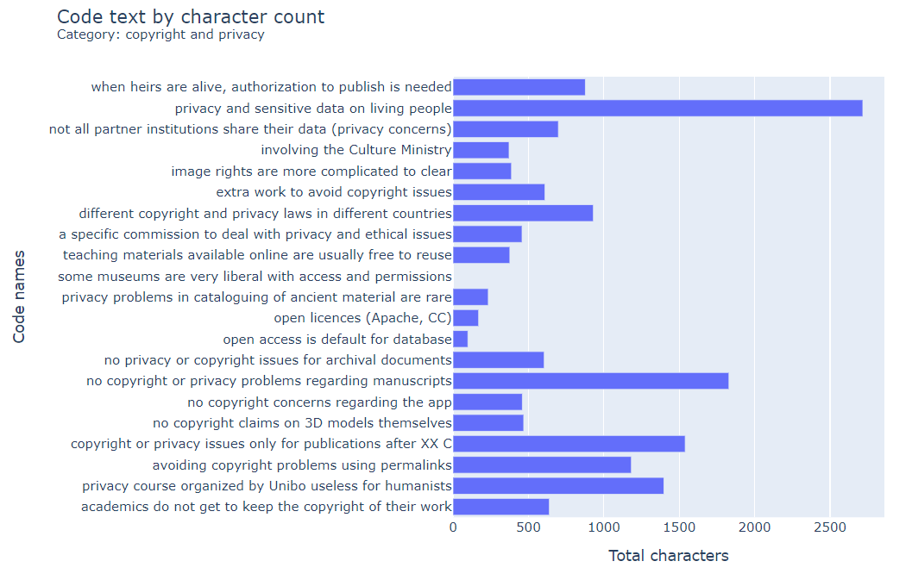
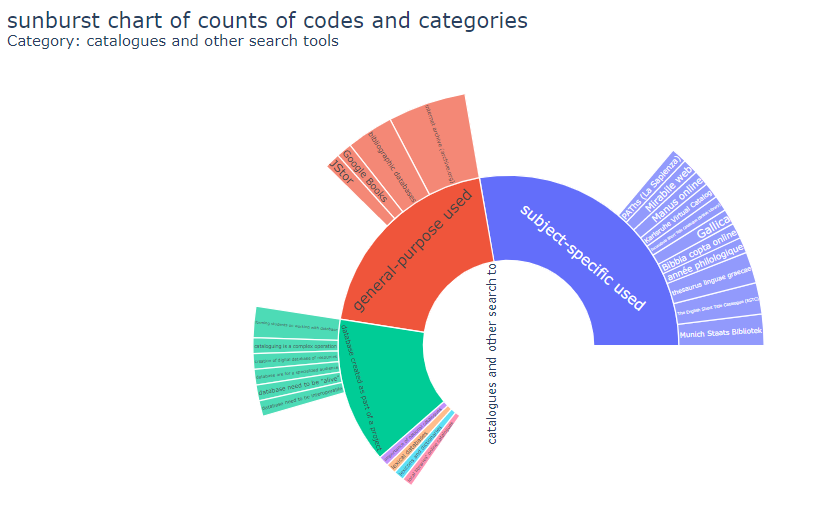
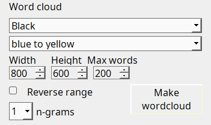

# Opciones del menú Informes

* Comparación de codificación: para archivos de texto (compara 2 codificadores)
* Comparación de codificación por archivo: para archivos de texto (compara 2 codificadores)
* Recuento de códigos por archivo o caso
* Frecuencia de códigos (totales de códigos aplicados)
* Resumen de archivos (detalles de un archivo y sus segmentos codificados)
* Resumen de códigos (detalles de un código y los archivos asociados)
* Gráficos (mostrar gráficos estadísticos y de otro tipo en un navegador web)
* Consultas a la base de datos (consulta de la base de datos, incluidas las consultas predeterminadas)

## Informe de comparación de codificación { #coding-comparison-report }

Esta opción muestra las similitudes y diferencias generales entre dos codificadores en todos los archivos de texto. Seleccione dos codificadores y haga clic en el botón de ejecutar comparaciones. Las estadísticas que se generan aquí son solo para texto codificado, no para imágenes ni archivos multimedia codificados.

Para cada código:

* Agreement % muestra el acuerdo para una combinación de caracteres de texto codificados y no codificados.
* A and B % muestra el acuerdo únicamente de los caracteres de texto codificados dividido entre el total de caracteres del texto.
* Not A and Not B % muestra el total del texto no codificado dividido entre el total de caracteres del texto.
* Disagree % muestra el porcentaje de todo el texto codificado y no codificado que no coincidió entre los codificadores. Es lo mismo que 100 menos el Agree %.
* Agree coded only % muestra el porcentaje de todo el texto codificado por ambos dividido entre el texto codificado por uno más el codificado por ambos.
* El Kappa de Cohen se calcula con base en la información de  [Wikipédia](https://en.wikipedia.org/wiki/Cohen%27s_kappa).

Botones para ejecutar las comparaciones, para borrar los codificadores seleccionados, para exportar a Excel y para abrir una ventana de ayuda sobre las estadísticas.

Haga clic derecho en un código para más opciones:

## Informe de comparación de codificación por archivo { #coding-comparison-by-file-report }

Esta opción muestra las similitudes y diferencias generales entre dos codificadores en UN archivo seleccionado. Seleccione un archivo, un código y dos codificadores. Luego haga clic en el botón de ejecutar comparaciones. Las estadísticas y comparaciones para segmentos codificados de audio y video están en desarrollo.
El acuerdo general, el desacuerdo y el Kappa de Cohen se calculan para texto e imágenes. Un archivo de imagen se muestra en una ventana aparte, presentando las selecciones de los dos codificadores en áreas enmarcadas en amarillo o azul. El texto en verde indica dónde ambos codificadores codificaron la misma sección de texto. Al pasar el ratón se proporciona información adicional.

## Informe de frecuencias de códigos { #code-frequencies-report }

Esta ventana muestra todos los códigos y categorías y la frecuencia de uso de cada codificador. Las frecuencias de códigos pueden seleccionarse para archivos concretos.

Haga clic derecho en un código para más opciones:

## Informe de resumen de archivo { #file-summary-report }

Haga clic en un archivo para obtener un resumen de ese archivo. Describe los metadatos multimedia, los caracteres y la frecuencia de palabras. Los atributos. Resume el conteo de códigos de ese archivo. Las codificaciones de texto resumen la longitud media del texto. Para las codificaciones de imagen resume el área media en píxeles. Para las codificaciones de audio y video resume la duración media del segmento.

A las 100 palabras más frecuentes se les aplican palabras vacías, de modo que se excluyen palabras de relleno comunes como 'a ', 'the', etc. Vea la lista en la _carpeta Examples_. Puede anular esta lista proporcionando su propio archivo de texto de palabras vacías y colocándolo en la _carpeta .qualcoder_.

Haga clic derecho en los archivos para más opciones:

## Informe de resumen de código { #code-summary-report }

Haga clic en un código para obtener un resumen de ese código. Los codificadores que han usado el código. El número de codificaciones en texto, imagen y audio o video. Las codificaciones de texto resumen la longitud media del texto y las palabras más comunes. Para las codificaciones de imagen resume el área media en píxeles. Para las codificaciones de audio y video resume la duración media del segmento.

A las 100 palabras más frecuentes se les aplican palabras vacías, de modo que se excluyen palabras de relleno comunes como 'a ', 'the', etc. Vea la lista en la _carpeta Examples_. Puede anular esta lista proporcionando su propio archivo de texto de palabras vacías y colocándolo en la _carpeta .qualcoder_.

Haga clic derecho en un código para más opciones:

## Gráficos { #charts }

Hay disponibles diversos tipos de gráficos y opciones de filtro.

La mayoría de los gráficos se muestran en el navegador web predeterminado. Si el navegador no muestra su gráfico, primero cambie su navegador predeterminado a otro navegador reciente, por ejemplo Firefox, Chrome, Edge o Safari. Si tiene javascript desactivado, los gráficos no se mostrarán. Marcar la casilla _Export html file_ hará que todos los gráficos se exporten a la carpeta de exportación predeterminada como archivo html.

Se pueden crear mapas de calor de archivos o casos frente a códigos. Están limitados a 40 filas y columnas para una representación más rápida y una mejor visibilidad.

_Selecciones de gráficos_

_Gráfico de barras_

_Gráfico sunburst_

_Mapa de calor_

De archivos o casos por códigos, muestra el calor de la frecuencia de los códigos.

_Gráficos de barras apiladas_

De archivos o casos por códigos, muestra la frecuencia de los códigos como gráfico de barras apiladas.

_Nube de palabras_

Hay disponible una nube de palabras con distintas opciones de color de fondo, color de primer plano o gama de colores, tamaño del rectángulo, número de palabras (n-gramas) de 1 a 4 y número máximo de palabras a incluir. El número máximo de palabras se determina de la más frecuente a la menos frecuente, y cambiar esta opción modificará cuán poblada o dispersa se ve la nube de palabras.

Existe una lista de palabras vacías que se usan para excluir palabras comunes de la visualización de la nube de palabras (por ejemplo, an, a, the). Esto puede anularse creando su propio archivo stopwords.txt con una palabra en cada línea. Este archivo debe colocarse dentro de la carpeta .qualcoder. Por ejemplo, en Windows:

"C:\Users\yourname\.qualcoder"

Las palabras vacías que se usan actualmente están en stopwords.txt, en la carpeta Examples. Como alternativa, en la 3.8+ puede usar el botón de la sección Wordcloud para vincular temporalmente otro archivo de palabras vacías que usted elija.

## Consultas de base de datos { #database-queries }

Aplique sentencias SQL para consultar la base de datos. Esta ventana contiene tres paneles. En el panel superior se introducen las sentencias SQL y el panel inferior contiene los resultados de las consultas. El panel izquierdo contiene las tablas y los nombres de los campos. Al hacer doble clic en el nombre de un campo, este se añade a la sentencia SQL. Los resultados pueden exportarse a un archivo delimitado. Si no está familiarizado con SQL, tenga cuidado, ya que podrá actualizar y eliminar datos además de seleccionarlos. Nota: algunos símbolos Unicode no se convierten a texto plano y se ignoran.

Hay varias sentencias preparadas disponibles:

* Case text
* Coded text using a case attribute selection (v3.6+)
* Codes fileid and coded text
* Get coding table: una implementación de una función de RQDA que devuelve el nombre del código, la tabla, la longitud del texto y las posiciones de inicio y fin del texto.
* Coded text with each case

La mayoría de los campos de las tablas son de texto. Los siguientes campos son enteros: anid, avid, attrid, caseid,catid, cid, fid, id, imid, jid, pos0,pos1, x1, y1, width, height.

Haga clic derecho en la tabla de resultados para acceder a las opciones de filtrado.

Al hacer clic derecho en la ventana de SQL obtiene diversas opciones, como seleccionar todo, copiar y pegar.

En la parte inferior de la lista del lado izquierdo puede ver: stored sql y Default queries

Stored sql son las sentencias sql creadas y almacenadas por usted mismo. Para almacenar una sentencia sql, haga clic derecho sobre la sql y elija 'save query'.

Default queries, como la que se muestra en la imagen, son consultas SQL predefinidas para realizar extracciones adicionales de sus datos. Están comentadas con '-- a comment' para describir qué hace cada sentencia.

Como puede realizar cualquier consulta sobre la base de datos, incluida la actualización de datos y la eliminación de tablas, conserve copias de seguridad; de lo contrario, es posible destruir la base de datos de forma irreparable.