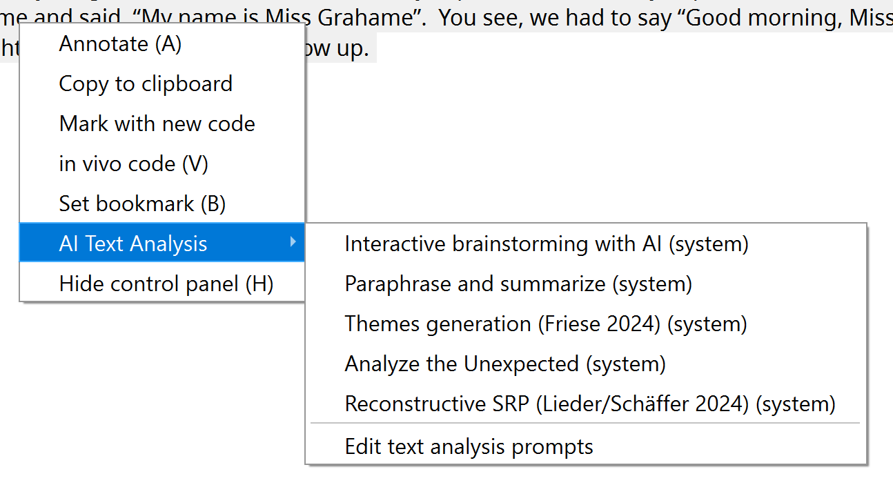
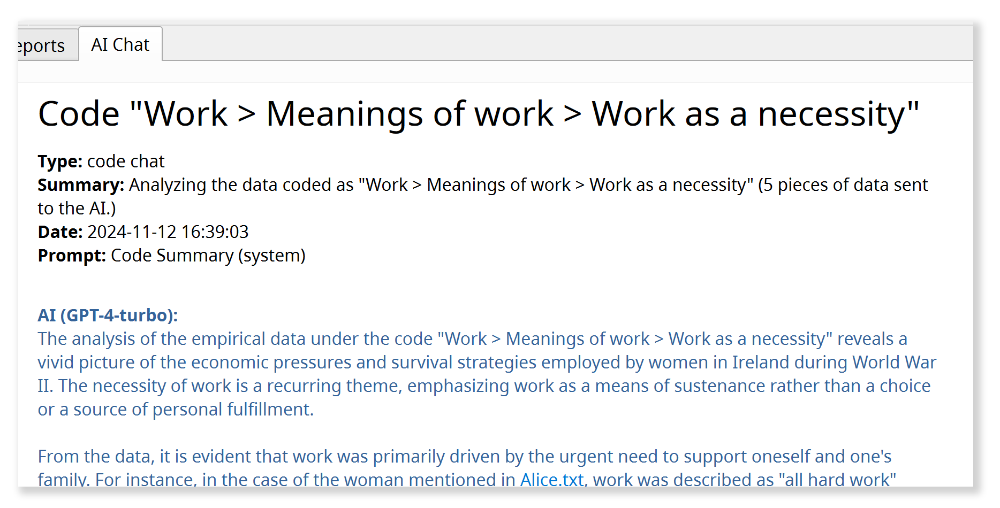

# Analisando dados com o agente de IA

## Princípios fundamentais da integração da IA

**1) Escolha dos modelos de IA**

O agente de IA em QualCoder não está ligado a um modelo específico. Você decide qual modelo de linguagem de IA usar, seja um dos grandes modelos comerciais, um modelo de médio porte em uma plataforma acadêmica de IA, ou um modelo de linguagem local em seu próprio computador. Para mais informações, consultar [Configuração do IA](./2.3.-AI-Setup.md).

**2) Flexibilidade metodológica

O agente de IA em QualCoder não define um método próprio. Em vez disso, fornece uma plataforma metodologicamente flexível para a experimentação. Sua pergunta de pesquisa, os insights que você procura, e sua abordagem metodológica definir a direção. Uma vez que uma abordagem provou ser útil, você pode salvá-lo e reutilizá-lo mais tarde (ver [Biblioteca AI Prompt](./6.3.-AI-Prompt-Library.md)).

**3) Transparência **

Os impulsos que orientam o trabalho do agente de IA são acessíveis e podem, em princípio, ser adaptados. Durante o trabalho, o agente também mantém você informado sobre suas etapas e fornece referências de fonte detalhadas. Isso permite que você veja quais dados ele baseia e examinar passagens em seu contexto original.

**4) Colaboração em vez de automação**

O foco é trabalhar com IA através do diálogo: desenvolver perspectivas adicionais, questionar suas próprias interpretações e obter uma melhor compreensão do material. A pedido, o agente também pode realizar tarefas mais longas de forma semi-autônoma. A automação em grande escala, no entanto, nunca foi o objetivo principal.

## Trabalhar com o agente de IA

- O agente de IA tem sua **separação ** em QualCoder. Você também pode movê-lo para uma barra lateral** (veja abaixo), ao lado de seus dados, clicando no botão seta pequena.
{ largura="118"}
- Na janela de chat, descreva em suas próprias palavras o que você gostaria de investigar ou trabalhar.

{largura="600"}

!!! note
    O IA deve estar ** totalmente carregado** e pronto para novas consultas antes de iniciar um chat (barra de status: "AI: pronto").

### Para que serve o agente de IA?

- O agente de IA ajuda você **explore seu material empírico,** desenvolva interpretações e análises, dados de código e escreva memorandos.
- Você pode discutir passagens individuais com a IA ou pesquisar todo o corpus do projeto para temas ou casos contrastantes.
- Você pode desenvolver seu sistema de código, ideias de brainstorm e estratégias analíticas, e confira-os diretamente com os dados empíricos.
- Ao contrário dos chatbots genéricos, o agente de IA em QualCoder ** capta exatamente onde sua análise parou:** examina o sistema de código atual, pode ler memorandos e passagens codificadas, incorporar casos e suas características (atributos) na análise, e muito mais. Isso lhe dá feedback adaptado à fase atual de sua pesquisa.

### O que pode o agente de IA fazer?

- Mesmo com apenas **read access** para o projeto, o agente de IA já é uma poderosa ferramenta de brainstorming.
- A pedido, pode também **avançar activamente a análise**. Com as permissões apropriadas (veja abaixo), ele pode criar novos códigos ou reorganizar os existentes, encontrar e codificar novas passagens de texto, revisar memorandos ou criar novos atributos de caso.
- Em conversa com o agente, você pode revisar sugestões, fazer perguntas de seguimento e decidir como proceder.

### Quais são as suas limitações?

- Atualmente, o agente de IA só pode trabalhar com ** dados de texto**, não com imagens, áudio ou vídeo. Os periódicos da QualCoder também estão excluídos por enquanto.
- Você pode escolher entre três níveis de permissão:

Nível de permissão
--------
*Somente leitura** O agente de IA só tem acesso lido a códigos, memorandos e dados empíricos.
*Sandboxed** (default)**Limited write access: o agente pode criar seus próprios códigos e códigos, mas não pode modificar os existentes.
* Acesso completo** O agente pode fazer quase tudo que um usuário humano pode, incluindo fazer alterações no sistema de código, casos, memorandos e atributos.

- Um **limite restrito** sempre se aplica: os documentos empíricos formam a "verdade de fundo" de toda a análise. Em nenhuma circunstância o IA pode modificá-los.
- O agente de IA também não tem ** acesso a informações externas,** como informações da internet. Portanto, ele só pode trabalhar com dados que você deliberadamente incluiu no projeto.

### Como posso ver que mudanças a IA faz?

- O agente ** documenta seus passos no chat,** fornece referências de origem, e pergunta antes de fazer grandes mudanças.
- Você pode facilmente **undo** as últimas alterações do agente de IA usando o botão correspondente na janela de bate-papo:

    {largura="250"}

- Todos os novos itens que o agente cria (códigos, códigos, etc.) são rotulados com o nome ** especial do codificador "AI Agent".**

    {largura="600"}

- Para mostrar ou ocultar** Códigos gerados por IA, clique nos três pontos ("...") no topo esquerdo da janela de codificação, próximo ao nome do codificador atual, e ajuste a visibilidade para "AI Agent".

    {largura="250"}

### Como devo preparar meu projeto?

- Um bom **project memo** é muito importante (menu: "Project > Project memo"). Deve conter:

    - A questão de investigação e os objectivos do projecto
    - O tipo de material empírico (por exemplo, entrevistas narrativas) e a abordagem de amostragem
    - A abordagem metodológica da análise
    - Quaisquer outros detalhes que o agente de IA deve ter em conta.

    O memorando do projeto é fornecido ao agente como informação de fundo para cada conversa.

- Além disso, **nomes de documentos** devem ser significativos (por exemplo, "Entrevista Alice").
- Em ** transcrições de entrevista**, entrevistadores e entrevistados devem ser claramente identificados para que seus papéis sejam reconhecíveis mesmo em trechos curtos.
- Bom **code memos** também ajudar a IA entender o que você quer dizer.

!!! note
    ** Verificar a prontidão do projeto IA:** Com este comando no menu "AI", o agente analisa automaticamente o projeto e sugere maneiras de melhorar sua legibilidade.

!!! note
    ** Notas pessoais em memorandos:** Se você também quiser usar memorandos para notas pessoais, escreva-os após o separador `#####`Tudo depois é inacessível para a IA.

### Como funciona o agente de IA?

- O agente de IA só age quando você lhe dá uma tarefa**, não por sua própria iniciativa.
- O agente trabalha através de uma tarefa em **ReAct loop** (Refletir + Acto, [Shunyu et al. 2022](https://arxiv.org/abs/2210.03629)):

    1. Cria um plano para a realização da tarefa.
    2. Realiza as ações planejadas (por exemplo, pesquisa de dados ou códigos de leitura).
    3. Analisa os resultados e decide se são necessárias mais acções (por exemplo, leitura de mais dados). Se assim for, retorna ao passo 2.

    Dependendo da complexidade da tarefa, este loop pode se repetir muitas vezes. Os passos individuais são mostrados em cinzento na janela de chat.
    Uma vez que o resultado é satisfatório (por exemplo, dados suficientes foram encontrados), o agente formula uma resposta final e espera por mais instruções.

- O agente tem **powerful tools** à sua disposição: por exemplo, ele pode realizar uma pesquisa de similaridade semântica em todo o corpus, pesquisar usando expressões regulares ou um índice de palavras-chave BM25, e chamar ferramentas para criar ou modificar códigos se ele tiver permissões de escrita.

### O que acontece aos meus dados?

- Todos os dados são mantidos **localmente em seu computador** no projeto QualCoder atual. As operações de pesquisa mencionadas acima também são executadas localmente.
- O modelo **AI só vê a parte dos dados** (por exemplo, resultados de busca ou passagens individuais) especificamente necessária para a análise atual. Esses fragmentos de dados são enviados para o modelo de IA juntamente com a tarefa relevante.
- Nas suas respostas, o agente de IA documenta em pormenor os dados em que as suas análises se baseiam. QualCoder transforma essas referências em **links de código com números de linha.** Clicar em uma referência abre a passagem em seu contexto original.

## Quatro maneiras de começar uma conversa com o agente

Na parte inferior esquerda da janela do agente de IA, você pode iniciar uma nova análise de uma das quatro maneiras:

{largura="250"}

Essas opções simplesmente fornecem **pontos de partida diferentes** para a análise. Você pode então levar a conversa em qualquer direção que você escolher, usando o conjunto de ferramentas completo disponível para o agente.

### 1) Novo chat aberto

Esta é a maneira mais flexível de iniciar uma nova análise com o agente. Comece com uma ideia ou uma pergunta aberta, ou nomeie os códigos ou passagens que você gostaria de investigar.

**Exemplo: Encontrar casos comparáveis

> *"A partir da linha 127, Sarah fala sobre sua infância na Inglaterra e como seu pai era seu principal cuidador lá. Existem casos semelhantes no material em que os homens desempenham um papel tão central no acolhimento de crianças?

**Exemplo: Códigos de consolidação**

> *"Tenho a impressão de que os códigos 'Responsabilidade pessoal' e 'Independência' muitas vezes se sobrepõem. Veja os memorandos e passagens codificadas. Como poderíamos distinguir os códigos mais claramente? Ou seria melhor fundi-los?"*
>
> Então: *"OK, mesclar ambos os códigos sob o novo nome 'Tomando responsabilidade por si mesmo' e atualizar o memorando de código em conformidade."*

**Exemplo: Recuperação de informações**

> *Examinar todas as entrevistas para identificar a posição de cada entrevistado sobre restrições ao uso das redes sociais por crianças e/ou adolescentes. Atribuir cada entrevistado a exatamente uma categoria:  
> **pro** = explicitamente a favor das restrições;  
> **contra** = explicitamente contra restrições;  
> **indeciso** = afirmações relevantes que são ambivalentes, contraditórias ou que não podem ser claramente atribuídas;  
> **desconhecido** = nenhuma declaração suficientemente relevante.  
> Considere apenas posições que possam ser claramente atribuídas ao entrevistado e verifique o contexto das passagens que encontrar. Primeiro, mostre-me a categoria proposta para cada pessoa, uma breve explicação, e as passagens-chave com referências de origem. Identificar explicitamente contradições e atribuições incertas.  
> Somente depois de confirmar, crie o atributo "social media restriction" para as transcrições da entrevista com os valores permitidos "pro", "contra", "indeciso" e "desconhecido", e salve as atribuições.*

Para incorporar ** prompts predefinidos ou seus próprios prompts** a partir do [Biblioteca AI Prompt](./6.3.-AI-Prompt-Library.md) na conversa, use 'slash notation': por exemplo, "/in-vivo-coding" inseriria o prompt correspondente que você criou anteriormente na Biblioteca Prompt na conversa atual.

### 2) Exploração de tópicos

Este tipo de análise é particularmente útil para obter uma ** visão inicial** de como um determinado tópico é discutido no material empírico. Para perguntas de pesquisa simples com tópicos claramente definidos, você também pode usar esta função para produzir análises de resumo que podem ser desenvolvidas diretamente em um relatório.

- Esta opção abre um **dialog** onde você pode definir e descrever o tópico e selecionar os dados a incluir na análise.
- Você também pode escolher entre diferentes **prompts analíticos**, como um simples resumo (tópico-síntese) ou uma análise de caso comparativa (análise-diferenças). Você pode criar modelos para suas próprias análises com instruções detalhadas no [Biblioteca AI Prompt](./6.3.-AI-Prompt-Library.md) e depois usá-los aqui.
- A exploração de tópicos primeiro realiza uma pesquisa multi-passo através do material e, em seguida, apresenta um relatório inicial.

**Exemplo: Comparação exploratória de casos

> ** Topic:** "Criar crianças durante a guerra"  
> **Descrição:** "Como a guerra afeta a decisão de ter filhos? Como é que o trabalho de cuidado muda durante a guerra? Como os pais tentam tornar possível a infância em condições de guerra?"  
> ** Prompt de análise:** "análise-diferenças"  
> **Filter:** Apenas os casos "Ethel" e "Flora" selecionados.  
>
> **Resultado:** Uma análise comparativa de Ethel e Flora sobre o tema "Levantando crianças durante a guerra", estruturado em torno das três subquestões.

### 3) Análise de texto

- Permite **fechar análise de uma passagem selecionada** com o agente IA.
- Desenvolver novas leituras e sugestões de código juntos, ou discutir ambiguidades, incertezas e questões de interpretação não resolvidas.

Esta análise primeiro muda para o espaço de trabalho de codificação de texto**.
Abra ali um documento, selecione a passagem que deseja analisar e escolha "Ai Text Analysis" no menu com o botão direito do mouse. A **submenu** abre onde você pode escolher entre diferentes tipos de análise de texto:

{largura="600"}

Passe por cima de uma entrada brevemente para ver uma dica com mais informações.
Você também pode salvar suas próprias instruções de análise de texto no [Biblioteca AI Prompt](./6.3.-AI-Prompt-Library.md). Eles aparecerão então como opções neste submenu também.

**Exemplo: Brainstorming nos estágios iniciais da leitura próxima**

> a) **Select** uma passagem de entrevista particularmente rica na aba "Código texto".  
> b) Botão direito do mouse, em seguida, escolha "AI Text Analysis" > **"interactive-brainstorming-with-ai"**.  
> c) A área de trabalho muda para o separador "AI Agent". Lá, o agente primeiro pergunta sobre a ** perspectiva analítica** ou o tópico que você gostaria de explorar em mais profundidade.  
> d) Uma ** conversa sobre o material** então começa, em que você explora e discute diferentes interpretações possíveis juntos.  
> e) **Salvar os resultados:** Quando terminar, instrua o agente de IA a guardar um resumo dos resultados como uma anotação de texto.

### 4) Análise de código

- Analisa todos os **dados recolhidos sob um determinado código ou categoria,** incluindo subcódigos.
- Discuta seus códigos com o agente de IA, compare códigos diferentes, crie subcódigos ou produza relatórios.
- Você também pode selecionar **multiple codes and/ou categories** para uma análise comparativa ou resumida.

Uma nova análise de código também começa abrindo um **dialog** onde você pode selecionar o(s) código(s) ou categorias para analisar, filtrar os dados para incluir e escolher um prompt analítico.
Você pode criar seus próprios prompts para esta função no [Biblioteca AI Prompt](./6.3.-AI-Prompt-Library.md) Também.

** Exemplo:**

> **Código:** "Solidariedade da vizinhança"  
> ** Prompt de análise:** "teórico-saturação-verificação"  
> **Filter:** Nenhum filtro (= todos os documentos estão incluídos).  
>
> ** Resultado:** Um relatório detalhado sobre a "saturação teórica" do código atual ou categoria selecionada no sentido da teoria fundamentada. O agente de IA busca ativamente o material para variações ainda não codificadas do fenômeno captado pelo código, para casos limítrofes e contraexemplos, para avaliar a saturação empírica e conceitual/teórica do código e identificar lacunas. O memorando de código também é levado em conta.

## Uma reflexão final sobre o antropomorfismo

Decidimos deliberadamente contra dar um nome ao agente de IA em QualCoder, como o "Claude" da Anthropic. No entanto, a abordagem da QualCoder à integração de IA através do diálogo encena uma espécie de pseudo-interação que, em muitos aspectos, segue padrões de interação humana, por exemplo, dentro de uma equipe de pesquisa. Na sua [prompt do sistema central](https://github.com/ccbogel/QualCoder/blob/master/src/qualcoder/ai_prompts/_agent.md), o agente de IA em QualCoder é atribuído precisamente esse papel como uma espécie de membro da equipe. Estamos, portanto, antropomorfizando uma máquina interagindo com ela como se fosse um pesquisador humano?

Até certo ponto, estamos. Mas me parece muito útil ver essas interações como uma espécie de "jogo de papel", como proposto por [Shanahan, McDonell & Reynolds 2023](https://www.nature.com/articles/s41586-023-06647-8)Os modelos de linguagem de IA atuais são treinados em interações linguísticas humanas. Eles, portanto, funcionam melhor quando incorporados em tais configurações de interação. No entanto, uma abordagem metodologicamente reflexiva da IA na pesquisa social qualitativa requer lembrar que estamos nos engajando em um papel induzido tecnologicamente, em vez de interagir com uma contraparte humana.

## Outras funções

- No **[Biblioteca AI Prompt](./6.3.-AI-Prompt-Library.md)**, você pode salvar estratégias analíticas bem sucedidas e abordagens metodológicas como instruções reutilizáveis para mais tarde.
- **[AI Codificação Assistida](./4.2.-AI-Assisted-Coding.md)** na área de trabalho 'Code text' usa uma pesquisa baseada em IA para ajudá-lo a encontrar passagens relevantes para um determinado código em todo o corpus.
- Se você tiver **perguntas sobre o uso do QualCoder**, o agente de IA pode ajudar com isso também, fornecendo respostas baseadas na documentação do QualCoder. Selecione * Ajuda > Pergunte ao agente de IA* no menu principal.
