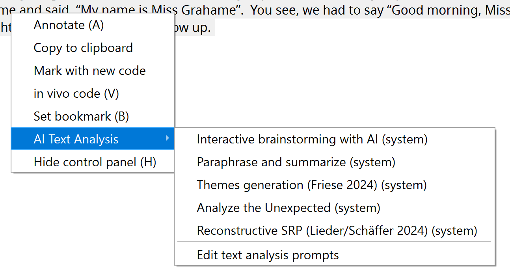
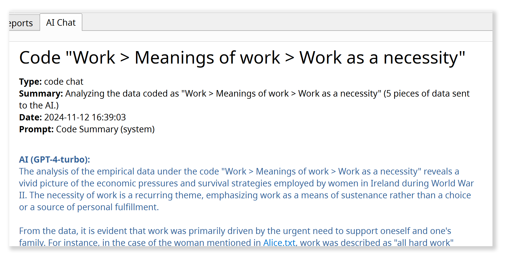

# Analisando dados com o agente de IA

## Princípios fundamentais da integração da IA {#core-principles-of-ai-integration}

**1) Escolha dos modelos de IA**

O agente de IA do QualCoder não está ligado a um modelo específico. Você decide qual modelo de linguagem de IA usar, seja um dos grandes modelos comerciais, um modelo de médio porte em uma plataforma acadêmica de IA, ou um modelo de linguagem local em seu próprio computador. Para mais informações, consulte a [Configuração da IA](./2.3.-AI-Setup).

**2) Flexibilidade metodológica**

O agente de IA do QualCoder não define um método próprio. Em vez disso, fornece uma plataforma metodologicamente flexível para a experimentação. Sua pergunta de pesquisa, os _insights_ que você procura, e sua abordagem metodológica definem a direção. Uma vez que uma abordagem provou ser útil, você pode salvá-la e reutilizá-la mais tarde (veja [Biblioteca de Prompts de IA](./6.3.-AI-Prompt-Library)).

**3) Transparência**

Os _prompts_ que orientam o trabalho do agente de IA são acessíveis e podem, em princípio, ser adaptados. Durante o trabalho, o agente também mantém você informado sobre suas etapas e fornece referências de fonte detalhadas. Isso permite que você veja em quais dados ele se baseia e examine passagens em seu contexto original.

**4) Colaboração em vez de automação**

O foco é trabalhar com a IA através do diálogo: desenvolver perspectivas adicionais, questionar suas próprias interpretações e obter uma melhor compreensão do material. Quando solicitado, o agente também pode realizar tarefas mais longas de forma semi-autônomo. A automação em grande escala, no entanto, nunca foi o objetivo principal.

## Trabalhando com o agente de IA {#working-with-the-ai-agent}

- O agente de IA tem sua própria **aba** no QualCoder. Você também pode movê-lo para uma **barra lateral** (veja abaixo), ao lado de seus dados, clicando na seta pequena.
{ width="118"}
- Na janela de chat, descreva em suas próprias palavras o que você gostaria de investigar ou trabalhar.

{width="600"}

!!! note
    A IA deve estar **totalmente carregada** e pronta para novas consultas antes de iniciar um chat (barra de _status_: "IA: pronta").

### Para que serve o agente de IA? {#what-is-the-ai-agent-for}

- O agente de IA ajuda você a **explorar seu material empírico**, desenvolva interpretações e análises, dados de código e escreva memorandos.
- Você pode discutir passagens individuais com a IA ou pesquisar todo o _corpus_ do projeto para temas ou casos contrastantes.
- Você pode desenvolver seu sistema de código, ideias de _brainstorm_ e estratégias analíticas, e conferí-los diretamente com os dados empíricos.
- Ao contrário dos _chatbots_ genéricos, o agente de IA do QualCoder **continua exatamente onde sua análise parou:** ele examina o sistema de código atual, pode ler memorandos e passagens codificadas, incorporar casos e suas características (atributos) na análise, e muito mais. Isso lhe dá _feedback_ adaptado à fase atual de sua pesquisa.

### O que pode o agente de IA fazer? {#what-can-the-ai-agent-do}

- Mesmo apenas com **acesso de leitura** ao projeto, o agente de IA já é uma poderosa ferramenta de _brainstorming_.
- Quando solicitado, pode também **avançar ativamente a análise**. Com as permissões apropriadas (veja abaixo), ele pode criar novos códigos ou reorganizar os existentes, encontrar e codificar novas passagens de texto, revisar memorandos ou criar novos atributos de caso.
- Em conversa com o agente, você pode revisar sugestões, fazer novas perguntas e decidir como proceder.

### Quais são as suas limitações? {#what-are-its-limitations}

- Atualmente, o agente de IA só pode trabalhar com **dados de texto**, não com imagens, áudio ou vídeo. Os diários do QualCoder também estão excluídos por enquanto.
- Você pode escolher entre três níveis de permissão:

Nível de permissão|Descrição
|---|---|
**Somente leitura**|O agente de IA só tem acesso de leitura a códigos, memorandos e dados empíricos.
**_Sandboxed_ ("isolado")** (padrão)|Acesso de escrita limitado: o agente pode criar seus próprios códigos e códigos, mas não pode modificar os existentes.
**Acesso completo**| O agente pode fazer quase tudo que um usuário humano pode, incluindo fazer alterações no sistema de código, casos, memorandos e atributos.

- Um **limite** sempre se aplica: os documentos empíricos formam a "verdade de fundo" de toda a análise. Em nenhuma circunstância a IA pode modificá-los.
- O agente de IA também não tem **acesso a informações externas**, como informações da internet. Portanto, ele só pode trabalhar com dados que você deliberadamente incluiu no projeto.

### Como posso ver que mudanças a IA faz? {#how-can-i-see-which-changes-the-ai-makes}

- O agente **documenta seus passos no chat,** fornece referências às fontes, e pergunta antes de fazer grandes mudanças.
- Você pode facilmente **desfazer** as últimas alterações do agente de IA usando o botão correspondente na janela de bate-papo:

    {width="250"}

- Todos os novos itens que o agente cria (códigos, códigos, etc.) são rotulados com o nome **especial do codificador "Agende de IA"**.

    {width="600"}

- Para **mostrar ou ocultar** os Códigos gerados por IA, clique nos três pontos ("...") no topo esquerdo da janela de codificação, próximo ao nome do codificador atual, e ajuste a visibilidade para "Agende de IA".

    {width="250"}

### Como devo preparar meu projeto? {#how-should-i-prepare-my-project}

- Um bom **memorando de projeto** é muito importante (menu: "Projeto > Memorando do Projeto"). Deve conter:

    - A questão de investigação e os objectivos do projeto
    - O tipo de material empírico (por exemplo, entrevistas narrativas) e a abordagem de amostragem
    - A abordagem metodológica da análise
    - Quaisquer outros detalhes que o agente de IA deve levar em consideração.

    O memorando do projeto é fornecido ao agente como informação de fundo para cada conversa.

- Além disso, os **nomes de documentos** devem ser significativos (por exemplo, "Entrevista Alice").
- Em **transcrições de entrevista**, entrevistadores e entrevistados devem ser claramente identificados para que seus papéis sejam reconhecíveis mesmo em trechos curtos.
- Um bom **memorando de códigos** também ajuda a IA entender o que você quer dizer.

!!! note
    **Verificar a preparação do projeto para a IA:** Com este comando no menu "IA", o agente analisa automaticamente o projeto e sugere maneiras de melhorar sua legibilidade.

!!! note
    **Notas pessoais em memorandos:** Se você também quiser usar memorandos para notas pessoais, escreva-os após o separador `#####`. Tudo depois dessa marca é inacessível para a IA.

### Como funciona o agente de IA? {#how-does-the-ai-agent-work}

- O agente de IA só age quando você lhe dá uma **tarefa**, não por sua própria iniciativa.
- O agente trabalha através de uma tarefa em um **ReAct _loop_** (Refletir + Agir, [Shunyu et al. 2022](https://arxiv.org/abs/2210.03629)):

    1. Cria um plano para a realização da tarefa.
    2. Realiza as ações planejadas (por exemplo, pesquisa de dados ou códigos de leitura).
    3. Analisa os resultados e decide se são necessárias mais ações (por exemplo, leitura de mais dados). Se assim for, retorna ao passo 2.

    Dependendo da complexidade da tarefa, este _loop_ pode se repetir muitas vezes. Os passos individuais são mostrados em texto acinzentado na janela de _chat_.
    Uma vez que o resultado é satisfatório (por exemplo, dados suficientes foram encontrados), o agente formula uma resposta final e espera por mais instruções.

- O agente tem **ferramentas poderosas** à sua disposição: por exemplo, ele pode realizar uma pesquisa de similaridade semântica em todo o _corpus_, pesquisar usando expressões regulares ou um índice de palavras-chave BM25, e chamar ferramentas para criar ou modificar códigos se ele tiver permissões de escrita.

### O que acontece aos meus dados? {#what-happens-to-my-data}

- Todos os dados são mantidos **localmente em seu computador** no projeto QualCoder atual. As operações de pesquisa mencionadas acima também são executadas localmente.
- O modelo **AI só vê a parte dos dados** (por exemplo, resultados de busca ou passagens individuais) especificamente necessária para a análise atual. Esses fragmentos de dados são enviados para o modelo de IA juntamente com a tarefa relevante.
- Nas suas respostas, o agente de IA documenta em pormenor os dados em que as suas análises se baseiam. O QualCoder transforma essas referências em **_links_ de código com números de linha.** Clicar em uma referência abre a passagem em seu contexto original.

## Quatro maneiras de começar uma conversa com o agente {#four-ways-to-start-a-conversation-with-the-agent}

Na parte inferior esquerda da janela do agente de IA, você pode iniciar uma nova análise de uma das quatro maneiras:

{width="250"}

Essas opções simplesmente fornecem **pontos de partida diferentes** para a análise. Você pode então levar a conversa em qualquer direção que você escolher, usando o conjunto de ferramentas completo disponível para o agente.

### 1) Novo chat aberto {#1-new-open-chat}

Esta é a maneira mais flexível de iniciar uma nova análise com o agente. Comece com uma ideia ou uma pergunta aberta, ou nomeie os códigos ou passagens que você gostaria de investigar.

**Exemplo: Encontrar casos comparáveis**

> *"A partir da linha 127, Sarah fala sobre sua infância na Inglaterra e como seu pai era seu principal responsável lá. Existem casos semelhantes no material em que os homens desempenham um papel tão central no acolhimento de crianças?

**Exemplo: Consolidar Códigos**

> *"Tenho a impressão de que os códigos 'Responsabilidade pessoal' e 'Independência' muitas vezes se sobrepõem. Veja os memorandos e passagens codificadas. Como poderíamos distinguir os códigos mais claramente? Ou seria melhor mesclá-los?"*
>
> Então: *"OK, mescle ambos os códigos sob o novo nome 'Tomando responsabilidade por si mesmo' e atualize o memorando de código em conformidade."*

**Exemplo: Recuperação de informações**

> *Examine todas as entrevistas para identificar a posição de cada entrevistado sobre restrições ao uso das redes sociais por crianças e/ou adolescentes. Atribua a cada entrevistado exatamente uma categoria:
> _**pró** = explicitamente a favor das restrições;_
> _**contra** = explicitamente contra restrições;_
> _**indeciso** = afirmações relevantes que são ambivalentes, contraditórias ou que não podem ser claramente atribuídas;_
> _**desconhecido** = nenhuma declaração suficientemente relevante._
> *Considere apenas posições que possam ser claramente atribuídas ao entrevistado e verifique o contexto das passagens que encontrar. Primeiro, mostre-me a categoria proposta para cada pessoa, uma breve explicação, e as passagens-chave com referências de origem. Identificar explicitamente contradições e atribuições incertas.*
> *Somente depois de confirmar, crie o atributo "restrição das redes sociais" para as transcrições da entrevista com os valores permitidos "pró", "contra", "indeciso" e "desconhecido", e salve as atribuições.*

Para incorporar ** prompts predefinidos ou seus próprios prompts** a partir do [Biblioteca AI Prompt](./6.3.-AI-Prompt-Library) na conversa, use 'slash notation': por exemplo, "/in-vivo-coding" inseriria o prompt correspondente que você criou anteriormente na Biblioteca Prompt na conversa atual.

### 2) Explorar tópicos {#2-topic-exploration}

Este tipo de análise é particularmente útil para obter uma **visão inicial** de como um determinado tópico é discutido no material empírico. Para perguntas de pesquisa simples com tópicos claramente definidos, você também pode usar esta função para produzir análises sintéticas que podem ser desenvolvidas diretamente em um relatório.

- Esta opção abre uma **caixa de diálogo** em que você pode definir e descrever o tópico e selecionar os dados a incluir na análise.
- Você também pode escolher entre diferentes **_prompts_ analíticos**, como um simples resumo (_topic-summary_) ou uma análise de caso comparativa (_analyze-differences_). Você pode criar modelos para suas próprias análises com instruções detalhadas na [Biblioteca de _Prompts_ de IA](./6.3.-AI-Prompt-Library) e depois usá-los aqui.
- A exploração de tópicos primeiro realiza uma pesquisa multi-passo através do material e, em seguida, apresenta um relatório inicial.

**Exemplo: Comparação exploratória de casos**

> _** Tópico:** "Criar crianças durante a guerra"_
> _**Descrição:** "Como a guerra afeta a decisão de ter filhos? Como é que o trabalho de cuidado muda durante a guerra? Como os pais tentam tornar possível a infância em condições de guerra?"_
> _** _Prompt_ de análise:** "_analyze-differences_"  _
> _**Filtro:** Apenas os casos "Ethel" e "Flora" selecionados_.
>
> _**Resultado:** Uma análise comparativa de Ethel e Flora sobre o tema "Levantando crianças durante a guerra", estruturado em torno das três subquestões_.

### 3) Análise de texto {#3-text-analysis}

- Permite **fechar a análise de uma passagem selecionada** com o agente IA.
- Desenvolver novas leituras e sugestões de código juntos, ou discutir ambiguidades, incertezas e questões de interpretação não resolvidas.

Esta análise primeiro muda para o espaço de trabalho de **Codificar texto**.
Abra ali um documento, selecione a passagem que deseja analisar e escolha "Análise de texto de IA" no menu com o botão direito do _mouse_. Um **submenu** abre onde você pode escolher entre diferentes tipos de análise de texto:

{width="600"}

Passe por cima de uma entrada brevemente para ver uma dica com mais informações.
Você também pode salvar suas próprias instruções de análise de texto no [Biblioteca de _Prompts_ de IA](./6.3.-AI-Prompt-Library). Eles aparecerão então como opções neste submenu também.

**Exemplo: _Brainstorming_ nos estágios iniciais da leitura próxima**

> _a) **Selecione** uma passagem de entrevista particularmente rica na aba "Codificar texto"_.
> _b) Botão direito do mouse, em seguida, escolha "AI Text Analysis" > **"interactive-brainstorming-with-ai"**._
> _c) A área de trabalho muda para a aba "Agente de IA". Lá, o agente primeiro pergunta sobre a **perspectiva analítica** ou o tópico que você gostaria de explorar em mais profundidade._
> _d) Uma **conversa sobre o material** então começa, em que vocês exploram e discutem diferentes interpretações possíveis juntos_.
> _e) **Salvar os resultados:** Quando terminar, instrua o agente de IA a guardar um resumo dos resultados como uma anotação de texto_.

### 4) Análise de código {#4-code-analysis}

- Analisa todos os **dados recolhidos sob um determinado código ou categoria**, incluindo subcódigos.
- Discute seus códigos com o agente de IA, compare códigos diferentes, crie subcódigos ou produza relatórios.
- Você também pode selecionar **múltiplos códigos e/ou categorias** para uma análise comparativa ou resumida.

Uma nova análise de código também começa abrindo uma **janela de diálogo** em que você pode selecionar o(s) código(s) ou categorias para analisar, filtrar os dados para incluir e escolher um prompt analítico.
Você pode criar seus próprios prompts para esta função no [Biblioteca de _Prompts_ de IA](./6.3.-AI-Prompt-Library) Também.

**Exemplo:**

> _**Código:** "Solidariedade da vizinhança_"
> _**_Prompt_ de análise:** "theoretical-saturation-check_"
> _**Filtro:** Nenhum filtro (= todos os documentos estão incluídos)_.
>
> _**Resultado:** Um relatório detalhado sobre a "saturação teórica" do código atual ou categoria selecionada no sentido da teoria fundamentada. O agente de IA busca ativamente o material para variações ainda não codificadas do fenômeno captado pelo código, para casos limítrofes e contraexemplos, para avaliar a saturação empírica e conceitual/teórica do código e identificar lacunas. O memorando de código também é levado em consideração_.

## Uma reflexão final sobre antropomorfismo {#a-final-reflection-on-anthropomorphism}

Decidimos deliberadamente contra dar um nome ao agente de IA do QualCoder, como o "Claude" da Anthropic. No entanto, a abordagem do QualCoder à integração de IA através do diálogo encena uma espécie de pseudo-interação que, em muitos aspectos, segue padrões de interação humana, por exemplo, dentro de uma equipe de pesquisa. No seu [_prompt_ central do sistema](https://github.com/ccbogel/QualCoder/blob/master/src/qualcoder/ai_prompts/_agent.md), o agente de IA do QualCoder é atribuído precisamente esse papel como uma espécie de membro da equipe. Estamos, portanto, antropomorfizando uma máquina interagindo com ela como se fosse um pesquisador humano?

Até certo ponto, estamos. Mas me parece muito útil ver essas interações como uma espécie de "_role play_(jogo de interpretação de papéis)", como proposto por [Shanahan, McDonell e Reynolds (2023)](https://www.nature.com/articles/s41586-023-06647-8). Os modelos de linguagem de IA atuais são treinados em interações linguísticas humanas. Eles, portanto, funcionam melhor quando incorporados em tais configurações de interação. No entanto, uma abordagem metodologicamente reflexiva da IA na pesquisa social qualitativa requer lembrar que estamos nos engajando em um papel induzido tecnologicamente, em vez de interagir com uma contraparte humana.

## Outras funções {#further-functions}

- Na **[Biblioteca de _Prompts_ de IA](./6.3.-AI-Prompt-Library)**, você pode salvar estratégias analíticas bem sucedidas e abordagens metodológicas como instruções reutilizáveis para mais tarde.
- A **[Codificação Assistida por IA](./4.2.-AI-Assisted-Coding)** na área de trabalho 'Codificar texto' usa uma pesquisa baseada em IA para ajudá-lo a encontrar passagens relevantes para um determinado código em todo o _corpus_.
- Se você tiver **dúvidas sobre o uso do QualCoder**, o agente de IA pode ajudar com isso também, fornecendo respostas baseadas na documentação do QualCoder. Selecione *Ajuda > Pergunte ao agente de IA* no menu principal.